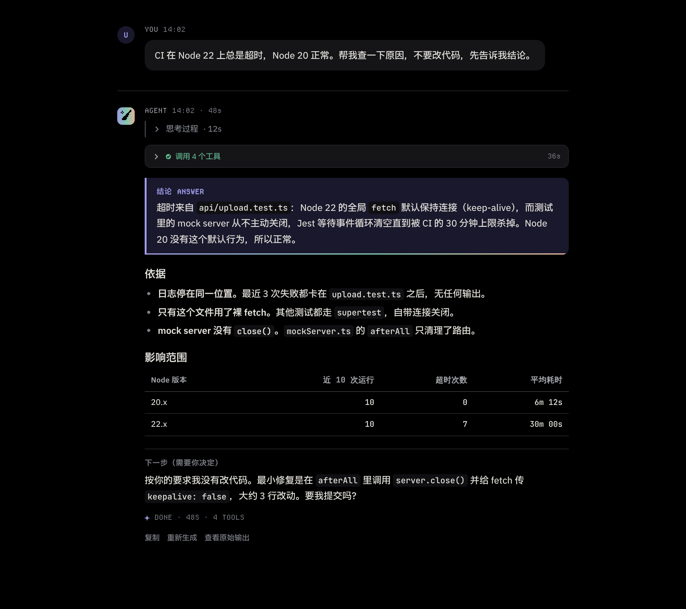
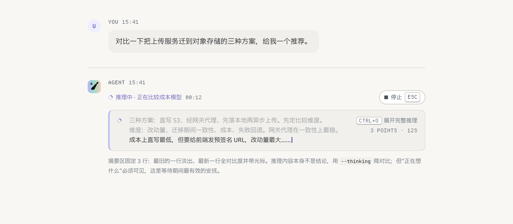
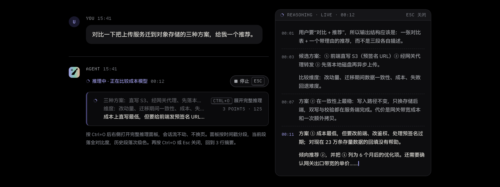
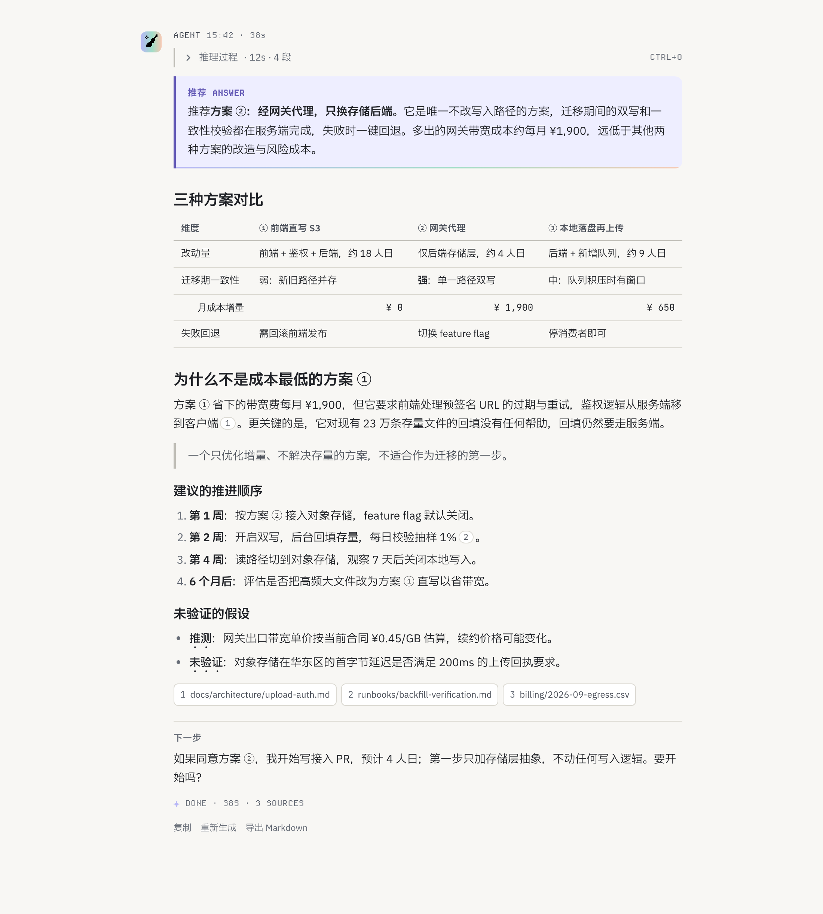
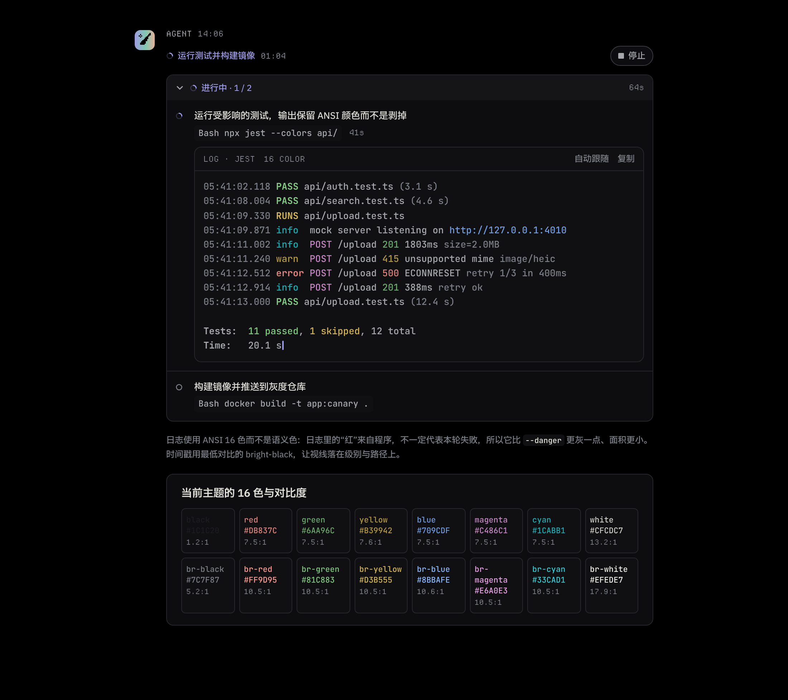
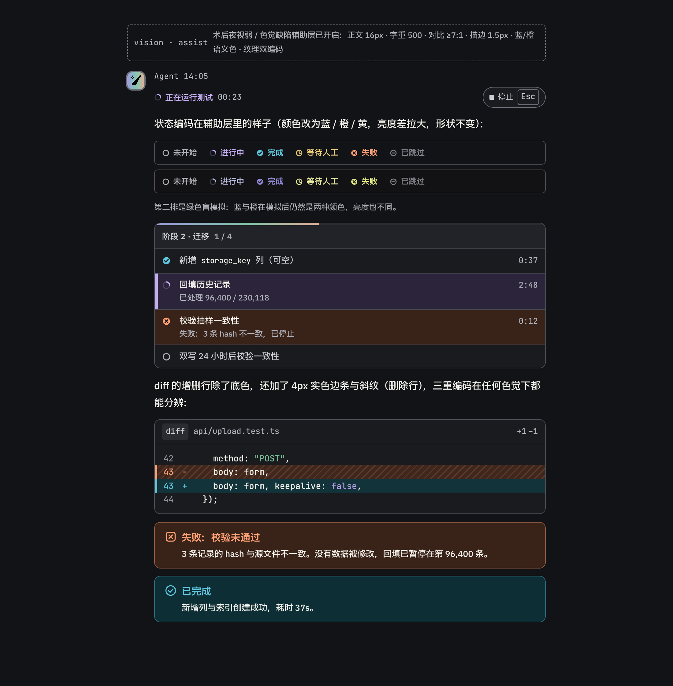
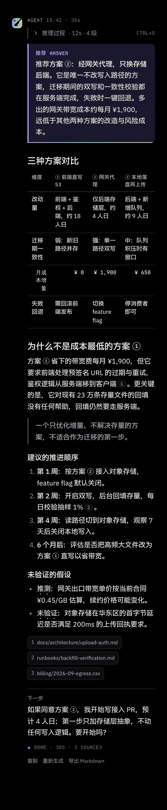
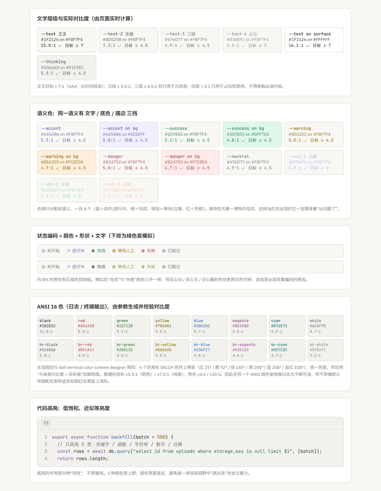

# Agent 会话窗口文本易读显示方案 v2

> 面向 **14–16 寸笔记本与手机** 的 Agent 对话界面文本显示规范。两套主题：**明亮**（暖纸白）与**纯黑**（OLED 真黑）；一层可叠加的**视觉辅助**（屈光手术后夜视弱 / 色觉缺陷）。
> 字体：中文 **IBM Plex Sans SC**，英文 **IBM Plex Sans**，日志与代码 **JetBrains Mono**，像素装饰 **Departure Mono**。
> 色彩参照 4-bit 终端配色器的参数化思路，但以 WCAG 对比度为约束由脚本生成并逐项校验。
> 风格：素雅、沉稳、轻快、现代，带数据的严肃性；彩蛋主题为独角兽，点缀只占视野的 1%。
> **每条决策都附"为什么"**，见各节的"理由"列与第 13 节汇总。

| 内容 | 位置 |
|---|---|
| 可运行原型（16 个场景、主题 / 辅助层 / 密度切换、流式模拟） | [`demo/index.html`](demo/index.html) |
| 色板（由脚本生成，含对比度校验） | [`demo/palette.css`](demo/palette.css) ← [`tools/palette.mjs`](tools/palette.mjs) |
| 设计令牌（字体、字号、间距、辅助层） | [`demo/tokens.css`](demo/tokens.css) |
| 组件样式 / 交互与图渲染 | [`demo/demo.css`](demo/demo.css) · [`demo/demo.js`](demo/demo.js) |
| 字体文件（OFL 授权；中文字体体积大，用脚本获取） | [`demo/fonts/`](demo/fonts/) · [`tools/fetch-fonts.sh`](tools/fetch-fonts.sh) |
| 截图脚本 / 39 张场景截图 | [`tools/shoot.mjs`](tools/shoot.mjs) · [`screenshots/`](screenshots/) |

---

## 0. 一页总览：十二条核心决策与理由

| # | 决策 | 理由 |
|---|---|---|
| 1 | **结论先行，过程可折叠** | 注意力是串行的；先给答案再给证据，推理与工具调用默认收起 |
| 2 | **Agent 正文不用气泡，开放排版** | Agent 输出是文档级长度；气泡压缩行长、反白增加眩光、右对齐打乱阅读起点 |
| 3 | **笔记本正文 15px / 1.7，手机 16px / 1.65，每行 32–42 字** | 55cm 视距下 15px ≈ 0.26° 字高，略高于汉字舒适下限 0.25°；手机视距近但单行字少，用 16px 保笔画 |
| 4 | **纯黑主题正文用 Plex Text 字重（450）** | 亮字在黑底上因光渗（irradiation）显得更细；用字重补偿而不是放大字号，行长不变 |
| 5 | **色相只分配给语义，一共 4 个** | 薰衣草紫＝动作/进行中、青绿＝完成、琥珀＝等待、玫红＝失败；装饰一律中性灰，红色一出现就一定是问题 |
| 6 | **颜色由参数生成而非手调** | 色相等距、统一色度、以对比度目标反解明度（4-bit 配色器思路）；任一颜色都能单独做文字 |
| 7 | **状态 = 颜色 + 形状 + 文字；辅助层再加纹理** | 约 8% 男性红绿色弱；亮度与形状比色相可靠 |
| 8 | **辅助层不用纯黑底** | 术后夜视弱者在高对比小亮元素周围看到光晕/星芒；深灰底 + 更粗笔画 + 更低峰值亮度比纯黑更清楚 |
| 9 | **推理进行中只显示 3 行滚动摘要，Ctrl+O 展开** | 等待期间“它在想什么”是最有效的安抚，但完整推理会淹没结论；按需展开且不换页 |
| 10 | **流式按帧批量渲染，布局只追加不回流** | 周边视觉对运动极敏感；逐 token 重绘是噪声，已读内容不得跳动 |
| 11 | **任何时候只有一个元素在动** | 一个 spinner 或一个光标；呼吸 ≥ 1.2s，禁止 >3Hz 闪烁 |
| 12 | **像素字体只排拉丁短标签** | Departure Mono 原生 11px 网格、无中文；用于角色名、计时、快捷键，给界面“终端感”而不伤正文可读性 |

---

## 1. 场景截图索引

由 `tools/shoot.mjs` 生成。桌面 1100px 宽 ≈ 14 寸笔记本 150% 缩放下的会话区；手机 390px；2× 像素比。字体为仓库内 IBM Plex Sans / Plex Sans SC / JetBrains Mono / Departure Mono。

| 场景 | 明亮 | 纯黑 | 辅助层 |
|---|---|---|---|
| 总览：一次完整问答 | [01](screenshots/01-overview-light.png) | [02](screenshots/02-overview-black.png) | [30 纯黑+辅助](screenshots/30-assist-overview-dark.png) |
| 流式输出中 | [03](screenshots/03-streaming-light.png) | [04](screenshots/04-streaming-black.png) | |
| **推理进行中的摘要**（3 行 + Ctrl+O 提示） | [05](screenshots/05-reasoning-summary-light.png) | [06](screenshots/06-reasoning-summary-black.png) | |
| **推理展开**（Ctrl+O 侧栏，不换页） | [07](screenshots/07-reasoning-open-light.png) | [08](screenshots/08-reasoning-open-black.png) | |
| **回复的结果文本**（长回答排版） | [09](screenshots/09-result-light.png) | [10](screenshots/10-result-black.png) | [31](screenshots/31-assist-result-light.png) |
| 工具调用三层结构 | [11](screenshots/11-tools-light.png) | [12](screenshots/12-tools-black.png) | |
| **日志 / 终端输出**（ANSI 16 色 + 对比度表） | [13](screenshots/13-terminal-light.png) | [14](screenshots/14-terminal-black.png) | |
| 计划清单 | [15](screenshots/15-plan-light.png) | [16](screenshots/16-plan-black.png) | |
| DAG 任务依赖图 | [17](screenshots/17-dag-light.png) | [18](screenshots/18-dag-black.png) | |
| 流程图 | [19](screenshots/19-flow-light.png) | | |
| 决策卡与提示框 | [20](screenshots/20-decision-light.png) | [21](screenshots/21-decision-black.png) | |
| 代码与 diff | [22](screenshots/22-code-light.png) | [23](screenshots/23-code-black.png) | |
| 字体排版样本 | [24](screenshots/24-typography-light.png) | [25](screenshots/25-typography-black.png) | |
| 色彩：层级 / 语义 / ANSI / 色盲模拟 | [26](screenshots/26-color-light.png) | [27](screenshots/27-color-black.png) | [32](screenshots/32-assist-color-light.png) · [33](screenshots/33-assist-color-dark.png) |
| **视觉辅助层专页**（状态、清单、diff 纹理、提示框） | [28](screenshots/28-assist-light.png) | [29](screenshots/29-assist-dark.png) | |
| 反例对照 | [34](screenshots/34-antipatterns-light.png) | | |
| 手机：总览 / 结果 / 推理摘要 / 辅助层 | [35](screenshots/35-mobile-overview-light.png) | [36](screenshots/36-mobile-result-black.png) · [37](screenshots/37-mobile-reasoning-black.png) | [38](screenshots/38-mobile-assist-overview-dark.png) |
| 紧凑密度 | [39](screenshots/39-compact-overview-light.png) | | |

### 预览

**总览 · 纯黑主题** — 独角兽点缀只在头像、结论框底边的虹彩线和收尾的 ✦：



**推理进行中的摘要** 与 **Ctrl+O 展开**：




**回复的结果文本**（明亮）：



**日志 / 终端**（纯黑，ANSI 16 色）：



**视觉辅助层**（深色）：



**手机**（结果文本 · 纯黑）与 **色彩自检**（明亮）：




---

## 2. 目标屏幕与尺寸推导

| 设备 | 典型分辨率 / 缩放 | 有效 CSS 宽度 | 视距 | 推导 |
|---|---|---|---|---|
| 14 寸笔记本 | 1920×1200 @150% / 2880×1800 @200% | 1280–1440px | 50–60cm | 15px 字高 ≈ 0.26°，汉字舒适下限约 0.25°；会话列 680px 留出侧栏仍不拥挤 |
| 16 寸笔记本 | 2560×1600 @150% / 3456×2234 @200% | 1512–1728px | 55–65cm | 同上，多余宽度给推理侧栏（400px）而不是拉长行 |
| 手机 | 390–430 CSS px | 30–35cm | 16px 正文、行高 1.65：视距近但一行只有 20–24 字，行高可略收；代码块横向滚动不换行 |

**字号阶梯**：11（像素标签）/ 12（元信息）/ 13（代码、次级）/ 15（正文）/ 17 / 20 / 24。辅助层整体 +1px；紧凑模式正文 14px。

---

## 3. 字体：为什么是这四款、怎么用

| 角色 | 字体 | 理由 | 用法约束 |
|---|---|---|---|
| 中文 | **IBM Plex Sans SC** | 与拉丁 Plex Sans 同一设计体系：字面大小、笔画粗细、重心一致，混排时**不需要**调整字号或基线；字形开阔、笔画均匀，在 15px 的笔记本屏上笔画不粘连 | 字重 400 / 500 / 600 / 700；中文不用斜体，强调用字重或着重号 |
| 英文 / 数字 | **IBM Plex Sans** | x 高度大、数字 `0 1 I l` 可辨；提供 **Text（450）** 字重，专为屏幕小字号设计 | 字体栈拉丁在前、中文回落，使数字与标点由 Plex Sans 承担；纯黑主题正文用 450 |
| 日志 / 代码 | **JetBrains Mono** | 字宽 0.6em 代码块不过宽；`0/O`、`1/l/I`、`{}()[]` 区分度高 | **关闭连字**（`=>` 不合成 `⇒`）：所见即所复制；13px，行高 1.6 |
| 像素装饰 | **Departure Mono** | 原生 11px 像素网格、形状硬朗，给界面"终端 / 数据"的严肃感，与独角兽的柔和虹彩形成反差 | 只排拉丁与数字短标签：角色名、时间、计时、快捷键、`ANSWER` 之类角标；**不组成句子**；只用 11px 或 22px；关闭抗锯齿保持像素锐利；辅助层中自动替换为 JetBrains Mono 13px |

字体栈：

```css
--font-sans:  "IBM Plex Sans", "IBM Plex Sans SC", "PingFang SC", "Microsoft YaHei", system-ui, sans-serif;
--font-mono:  "JetBrains Mono", "IBM Plex Mono", ui-monospace, monospace;
--font-pixel: "Departure Mono", "JetBrains Mono", monospace;
```

`@font-face` 先 `local()` 再 `url()`：用户机器已安装即不下载。拉丁 Plex Sans（5 个字重共 330KB）与 Departure Mono（22KB）随仓库提供；Plex Sans SC 每字重约 4MB，用 `tools/fetch-fonts.sh` 从 npm 拉取。

---

## 4. 色彩系统

### 4.1 两套主题的底与字

| | 明亮 | 纯黑 | 理由 |
|---|---|---|---|
| 页面底 | `#F8F7F4` 暖纸白 | `#000000` | 明亮：纯白大面积眩光；纯黑：OLED 像素关闭，真黑无漏光、省电、与系统纯黑模式一致 |
| 面 / 卡片 | `#FFFFFF` → `#E7E6E1` | `#0D0D0F` → `#1D1D21` | 深色层级靠"更亮的面"而不是阴影 |
| 正文 | `#1F2126` 15.0:1 | `#E2E0DA` 15.9:1，字重 450 | 不用纯黑字 / 纯白字；黑底白字 21:1 会产生光晕，15–16:1 足够 |
| 次级 / 三级 / 占位 | 7.3 / 4.9 / 3.3 | 8.8 / 5.5 / 3.4 | 三级只用于元信息；占位不承载必读内容 |
| 推理文字 | `#5D636D` | `#999CA3` | 刻意比正文低一档，表达"这是过程不是结论" |

### 4.2 语义色：参数化生成

全部颜色由 `tools/palette.mjs` 生成（`node tools/palette.mjs` 重新生成并打印校验报告）：

1. 在 **OKLCH** 色空间选定色相：主色薰衣草紫 **285°**（独角兽），完成 162°（青绿），等待 78°（琥珀），失败 18°（玫红）。相邻语义色相差 ≥ 60°。
2. 统一**低色度**（C = 0.10–0.14）——这是"素雅、沉稳"的数学定义：色度低则不刺眼，色相仍可辨。
3. 用"与背景对比度 = 目标值"**反解明度**：明亮主题目标 ≥ 5.0，纯黑主题 ≥ 7.5。
4. 每个语义色再派生底色（L 0.955 / 0.22）与描边色，校验"语义色文字在自己的底色上 ≥ 4.5"。
5. 超出 sRGB 色域时降低色度而不是裁剪，保证色相与明度不变。

结果（明亮 / 纯黑）：accent `#645AB6` / `#A09DEA`，success `#207855` / `#62B58E`，warning `#8E6202` / `#DBAB5F`，danger `#B24750` / `#E07F82`。全部 ≥ 目标，详见截图 26 / 27 的实时计算。

### 4.3 ANSI 16 色（日志 / 终端）

与 4-bit terminal color scheme designer 相同的参数化思路：6 个色相等距（红 25° / 黄 92° / 绿 145° / 青 200° / 蓝 258° / 品红 328°），统一色度，然后由对比度目标反解明度：

| | 普通 8 色 | 亮 8 色 | 说明 |
|---|---|---|---|
| 明亮主题 | ≥ 5.5:1（更深） | ≥ 4.6:1（略浅） | 明亮主题的"亮色"是更浅的一档，仍可做正文 |
| 纯黑主题 | ≥ 7.5:1 | ≥ 10.5:1 | 默认终端里蓝色、暗红在黑底上消失的问题不会出现 |

日志里的红来自程序输出，不等于本轮失败，所以 ANSI 红比 `--danger` 更灰、面积更小；时间戳用 bright-black（最低对比），视线落在级别与路径上。见截图 13 / 14。

### 4.4 代码高亮

5 类词性（关键字 / 函数 / 字符串 / 数字 / 注释），同样由对比度目标生成、亮度接近、低饱和。diff 增删行用底色 + 行首符号 + 行号颜色三重标记。

### 4.5 独角兽点缀

| 元素 | 做法 | 为什么只在这里 |
|---|---|---|
| Agent 头像 | 薰衣草→薄荷→蜜桃的虹彩渐变底 + 像素风独角兽角（12×12 网格，`crispEdges`） | 身份标识，每轮一次，位置固定在左轨道 |
| 结论框底边 | 2px 虹彩发丝线 | 结论是每条消息唯一被"加冕"的块 |
| 进度条填充 | 同一渐变 | 进度是非语义装饰，可承载气氛 |
| 完成行 | `✦ DONE · 48S · 4 TOOLS`（像素字体） | 落定感；✦ 用 `--uni-1` |
| 主色 | 薰衣草紫 285° 取代常见的蓝 | 让"活泼"渗入动作色而不增加色相数量 |

不出现在：正文、状态色、按钮、图表。三色都经过低色度处理（C ≤ 0.10），放在素雅的灰底上才成立。

---

## 5. 视觉辅助层：术后夜视弱 / 色觉缺陷

`data-vision="assist"` 可叠加在任一主题上（截图 28–33、38）。

### 5.1 人群特征 → 对应措施

| 特征 | 发生在 | 措施 | 理由 |
|---|---|---|---|
| **对比敏感度下降**（LASIK / PRK 后常见，暗环境更明显） | 夜间、深色主题 | 所有层级对比 ≥ 7:1，正文 ≥ 10:1；取消低于 4.5:1 的任何文字 | 对比敏感度曲线整体下移，原本"够用"的 4.5:1 不够了 |
| **光晕 / 星芒（halo / starburst）** | 黑底上的小而亮的元素 | 深色辅助层底改为 `#121316` 深灰而非纯黑；文字明度 `#F1EFE9` 而非纯白；描边 1.5px；不用细发丝线 | 亮暗边缘对比越极端，散射光晕越明显；深灰底把动态范围压小，同时更粗的笔画让光晕"吃掉"的边缘比例下降 |
| **高阶像差导致细笔画模糊** | 小字号、细字重 | 正文 16px、字重 500、行高 1.75；像素字体替换为 JetBrains Mono 13px | 增加笔画宽度比增加字号更有效地提升可辨性，且不缩短行长 |
| **蓝色聚焦困难**（色差，蓝光聚焦在视网膜前） | 深色底上的饱和蓝 | 深色辅助层的"完成"用天蓝 215°（高亮度、低饱和），不用纯蓝 | 避免蓝色文字"浮起"与边缘发虚 |
| **红绿色觉缺陷**（deutan / protan，约 8% 男性） | 所有状态编码 | 语义色改为 **蓝 / 橙 / 黄 / 紫**，彼此亮度差拉开；状态图标形状不变并放大到 12–14px；diff 删除行加斜纹、增加行加 4px 实色边条；计划清单当前项左条 5px | 蓝—橙是对所有常见色觉缺陷最稳的对立对；纹理与形状是与颜色无关的第三编码 |
| **眩光敏感** | 明亮主题 | 底 `#FBFAF7`，减少纯白面积；链接下划线加粗到 1.5px | 维持明亮主题的同时降低峰值亮度差 |

### 5.2 辅助层色板（由同一脚本生成）

| 语义 | 明亮辅助 | 深色辅助 | 对比度目标 |
|---|---|---|---|
| 动作 / 进行中 | 紫 300° `#603B93` | 淡紫 `#C4ACF1` | ≥ 7 |
| 完成 | 蓝 245° `#025284` | 天蓝 215° `#60C6DE` | ≥ 7 |
| 等待 | 深黄 85° `#654A00` | 黄 90° `#ECCD78` | ≥ 7 / ≥ 12 |
| 失败 | 朱红橙 40° `#8E2E01` | 橙 45° `#FFA074` | ≥ 7 |

> 具体十六进制以 `demo/palette.css` 为准（脚本每次生成都会打印校验结果，当前全部达标）。

---

## 6. 排版与布局

```
┌ 28px 轨道 ┬──────────── 正文列 ≤ 680px ───────────────────┐
│ 头像      │ AGENT 14:02 · 48S              ← 像素字体元信息   │
│ (虹彩+角) │ ▸ 思考过程 · 12s               ← 折叠，灰          │
│           │ ┌ ✓ 调用 4 个工具 · 36s ┐       ← 折叠卡片          │
│           │ ┃ 结论 ANSWER ………………… ┃       ← 唯一的结论框       │
│           │ ╰────── 虹彩 2px ──────╯                            │
│           │ 依据 / 表格 / 代码 ……                                │
│           │ ── 下一步 ──                                         │
│           │ ✦ DONE · 48S · 4 TOOLS         ← 落定行             │
└───────────┴─────────────────────────────────────────────────┘
```

- 左侧统一轨道线：所有消息类型文字左缘对齐，F 型扫视沿一条线下行。
- 用户消息保留气泡（短、需身份区分）；Agent 消息开放排版。
- 轮次 32px + 发丝线；块间 12–16px；列表项 4px。三层间距拉开差距，层级才可感知。
- 嵌套 ≤ 2 层；消息内标题 ≤ 2 级；500 字以内不用标题。
- 表格：发丝线、表头 12px、数字右对齐等宽（`tabular-nums`）；不用斑马纹。
- 代码块：文件名头 + 语言角标（像素字体）+ 行号；>24 行折叠保留首尾。
- 行内 CSS：`line-break: strict`、`overflow-wrap: anywhere`、`text-autospace: normal`（中西文留隙，渐进增强）。

---

## 7. 文本内容的易读性（Agent 写作规范）

| 规则 | 做法 | 理由 |
|---|---|---|
| 结论先行 | 第一块就是 `.answer` | 首因效应；中途停止阅读也拿到答案 |
| 一句一意 | 中文 ≤ 40 字；不用分号串句 | 工作记忆一次只装一个命题 |
| 一段一想法 | ≤ 4 句 | 段落是视觉块，块太大就没有块 |
| 并列用列表 | 3–7 项，顺序重要才编号 | 列表把结构从语法里拿出来给眼睛 |
| 只加粗引导词 | 列表项前 2–6 字 | 加粗是路标，满页路标等于没有路标 |
| 数字进表格、代码进代码块 | | 数字需要对齐才能比较；代码需要等宽才能对齐 |
| 不叙述过程 | 过程在工具卡里 | 重复信息消耗注意力 |
| 不确定显式标出 | "推测：" / "未验证：" 作引导词 | 信任来自诚实的边界 |
| 结尾交棒 | "下一步" 块 + 问句 | 峰终效应；让用户知道球在自己手里 |
| 红色、感叹号、emoji 不做修辞 | 红只给失败；图标用 SVG | 保护红色的语义；emoji 渲染不一致 |

流式写作：前置关键信息；不输出需要回头修改的话；清单类内容原位更新而不是重复输出。

---

## 8. 分类显示：消息类型与视觉签名

| 类型 | 视觉签名 | 默认状态 | 截图 |
|---|---|---|---|
| 用户消息 | 圆头像 `U`、灰气泡 | 展开 | 01 |
| Agent 正文 | 无气泡、680px 列 | 展开 | 01 / 09 |
| **推理摘要（进行中）** | 左 3px 淡紫条、灰底、3 行滚动、最新行全对比 + 光标、右侧 `CTRL+O` 提示与 `3 POINTS · 12S` | 进行中可见 | 05 / 06 |
| **推理面板（Ctrl+O）** | 右侧 400px 粘性面板，`REASONING · LIVE · 00:12` 头，按时间戳分段，当前段全对比 | 按需 | 07 / 08 |
| 思考过程（已结束） | 左 2px 灰线、一行摘要 `· 12s · 4 段` + `ctrl+o` | 折叠 | 09 |
| 工具调用组 | 灰头卡片，汇总 `N 个工具 · 36s` | 完成后折叠 | 01 / 11 |
| 单个工具 | 意图 → 机制（code 片 + 像素计时）→ 输出 | 输出折叠；失败自动展开 | 11 |
| **日志 / 终端** | `.term`：`LOG · JEST` 像素头、ANSI 16 色、bright-black 时间戳 | 进行中展开、自动跟随 | 13 / 14 |
| 计划 / 清单 | 阶段头 + 虹彩进度条 + 六种状态图标 | 展开 | 15 |
| 结论框 | 左 3px 主色条 + 淡紫底 + `结论 ANSWER` + 虹彩底线 | 展开，每条消息 ≤ 1 | 01 |
| 提示框 | 图标 + 标题 + 正文，四种语义 | 展开，每条消息 ≤ 1 个红 | 20 |
| 决策卡 | 琥珀描边 + 单选项卡片，推荐项首位并写理由 | 展开并阻塞 | 20 |
| 代码 / diff | 文件头 + 像素语言角标 + 三重增删标记 | ≤ 24 行展开 | 22 |
| DAG / 流程图 | 卡片 SVG + 图例 + 文字版 | 展开 | 17 / 19 |
| 落定行 | `✦ DONE · 48S · 4 TOOLS` | 完成后出现 | 01 |

---

## 9. 思维引导

1. **视觉层级 = 阅读顺序**：状态行 → 结论框 → 依据 → 细节（折叠）→ 下一步。字号、对比度、位置一致递减。
2. **用对比度编码时间**：已完成灰 + 删除线（辅助层取消删除线改用次级色），当前项主色底 + 左条 + 字重 500，未开始只有虚线轮廓。
3. **先意图后机制**：工具卡第一行说"为什么做"。
4. **一个焦点**：同时只有一个 running、一个结论框、一个红块。
5. **推理摘要的三行结构**：旧 → 新 → 正在写，读者看到"思路在前进"而不是"在转圈"。
6. **分块命名**：3–5 个操作归为一个阶段。
7. **诚实的默认效应**：推荐项预选并写明理由与其他选项代价；不可逆操作不能作为默认。
8. **明确交棒**：以"下一步" + 问句结束。

---

## 10. 流程图与 DAG

- ≥ 4 个有依赖/并行的任务用 **DAG**（左→右分层、泳道标阶段）；判断逻辑用**流程图**（上→下、菱形判断、Yes/No 标在边上）；否则用列表。
- 节点 ≤ 12，超过拆子图折叠；文字水平不旋转；节点标签 ≤ 8 字。
- 边：已完成绿实线、当前路径主色粗线、未来灰虚线。节点状态图标与全局同一套 SVG symbol。
- **图下方永远附文字版**：可读屏、可复制、可搜索、渲染失败回退。
- 只有 running 节点有动画；`prefers-reduced-motion` 与截图模式下静止。

---

## 11. 人类视觉生理依据

| 生理事实 | 推导规则 |
|---|---|
| 中央凹约 2°，一次注视 4–5 个汉字 | 15–16px + 行高 1.65–1.7 降低单次注视负荷 |
| 回扫是眼跳误差最大的动作 | 行长 32–42 字 |
| 对比敏感度在中频最高，细笔画小字号落在低敏区 | 12px 下限；中文不用 300 字重；纯黑主题正文 450 |
| 光渗：亮字在黑底上显细 | 纯黑主题加字重不加字号 |
| 亮度通道负责形状，色度通道分辨率低 | 状态用亮度差 + 形状，色相只是第三保险 |
| 8% 男性红绿色弱 | 绿/红永不单独承担语义；原型内置绿色盲模拟 |
| 散光 / 术后高阶像差：亮暗边缘产生光晕星芒 | 纯黑主题文字 ≈ 16:1 不到 21:1；辅助层改深灰底 + 粗笔画 |
| 蓝光聚焦在视网膜前 | 深色底不用饱和纯蓝做文字；ANSI 蓝提亮到 `#709CDF` |
| 周边视觉对运动极敏感 | 单一运动元素；光标 1Hz；spinner 1.2s/圈 |
| F 型扫视 | 左轨道对齐；关键信息在每块左上 |

---

## 12. 心理暗示与认知效应

| 效应 | 用法 | 红线 |
|---|---|---|
| 系统状态可见性 | 状态行：在做什么 + 计时 + 怎么停；推理摘要让"在想什么"可见 | 不做假进度 |
| Zeigarnik 效应 | 空心圈驱动完成感 | 不留永不关闭的空心圈 |
| 隔离效应 | 唯一的结论框 + 虹彩线 | 多于一个即失效 |
| 首因 / 近因 | 结论开头、下一步结尾 | 关键信息不埋中段 |
| Hick 定律 | 决策 ≤ 4 项 | 不用"其他"凑数 |
| 默认效应 | 预选推荐项 | 必须写理由与代价 |
| 学得的颜色语义 | 红只给失败 | 红不做装饰 |
| 峰终定律 | `✦ DONE` 落定行 + 下一步 | 不以客套收尾 |
| 气质暗示 | 像素字体 = 严谨的数据感；虹彩 = 轻快；低色度 = 沉稳 | 虹彩面积 ≤ 视野 1%，像素字体不写句子 |

---

## 13. Agent 交互与流式输出

| 问题 | 规则 |
|---|---|
| 逐 token 重绘 | `requestAnimationFrame` 批量追加，每帧 ≥ 32–48ms（原型 `?scene=streaming&live=1`） |
| 布局回流 | 只追加不回流；图表占位固定宽高比；进行中的工具卡固定高度 |
| 不完整 Markdown | 未闭合围栏立即按代码块渲染并显示"接收中…"；未闭合 `**` 先按普通文本 |
| 光标 | 2px 主色竖条；流式期间静止，停顿 > 500ms 才 1Hz 呼吸；结束 200ms 淡出 |
| 推理摘要 | 固定 3 行，新句进入时旧句上移淡出；`Ctrl+O` 打开侧栏，会话流不动；`Esc` 关闭 |
| 自动滚动 | 用户在底部 80px 内才跟随；上滚后显示"↓ 有新内容"浮标 |
| 工具时间线 | 进行中展开；全部完成且正文开始后折叠；失败项永不自动折叠 |
| 日志 | 保留 ANSI 颜色映射到主题 16 色；自动跟随可关；长输出首尾折叠 |
| 原位更新 | 清单 / 计时 / 进度 DOM diff，不整块重渲染 |
| 时间预算 | ≤ 300ms 出现占位；≤ 1s 首个 token 或工具意图；> 2s 显示计时；> 10s 说明在等什么 |
| 结束 | 状态行移除、光标淡出、`✦ DONE` 与操作栏淡入，无其他动画 |
| 可中断 | 停止按钮常驻状态行右端 + `ESC`；停止后保留内容并标注 |
| 无障碍 | `aria-live="polite"` 按句通知；`<details>` 原生可达；减少动效偏好下动画归零 |

---

## 14. 设计理由汇总（为什么这样设计）

- **为什么两个主题是"暖纸白"和"纯黑"而不是"白"和"深灰"**：明亮主题要降低大面积眩光，暖白比纯白舒服且不显旧；纯黑是用户要求，也是 OLED 上唯一能做到"像素关闭"的底色，与系统级纯黑模式衔接。纯黑的代价（光晕）用"文字不纯白 + Text 字重 + 面用更亮灰"来抵消，而把真正怕光晕的人群交给辅助层的深灰底。
- **为什么颜色由脚本生成**：手调的配色在换主题、换人群时会失控。参数化后，"素雅"是色度上限，"可读"是对比度下限，"主题"只是背景与目标值不同——同一份参数生成明亮 / 纯黑 / 两种辅助层共 4 套且全部通过校验。
- **为什么主色是薰衣草紫**：独角兽主题需要一个有辨识度又不刺眼的主色；紫在 OKLCH 285° 低色度时既"活泼"又"安静"，且与青绿 / 琥珀 / 玫红拉开足够色相距离。
- **为什么像素字体只做标签**：Departure Mono 没有中文，11px 网格不适合长文本，但作为 `AGENT 14:02`、`DONE · 48S`、`CTRL+O` 这类短标签，它给界面一种终端与数据仪表的严肃感，正好平衡虹彩的柔。
- **为什么推理只给 3 行**：完整推理会把结论推出首屏，但完全隐藏又让人焦虑；3 行是"看得见在想什么"与"不淹没答案"的平衡，Ctrl+O 把选择权交给用户。
- **为什么辅助层是叠加层而不是第三个主题**：夜视弱与色盲用户同样有明亮 / 深色的偏好；叠加层让他们保留主题选择，只替换会出问题的那部分（对比、笔画、色相、底色）。
- **为什么 15px 而不是 16px（笔记本）**：在 50–60cm 视距和 680px 行宽下，15px 让一行恰好 40 字左右；16px 会把行长压到 36 字以下或迫使列更宽。手机视距更近、列更窄，16px 才合适。

---

## 15. 验收检查表

**字体与排版**
- [ ] 笔记本正文 15px / 1.7，手机 16px / 1.65，列宽 ≤ 680px
- [ ] 拉丁与数字由 Plex Sans 渲染，中文由 Plex Sans SC 渲染（检查字体栈顺序）
- [ ] 纯黑主题正文字重 450；辅助层 500
- [ ] 像素字体只出现在 11px / 22px 的拉丁短标签；辅助层中已替换
- [ ] 等宽字体关闭连字；表格 / 计时用等宽数字

**色彩**
- [ ] 四套色板全部由 `palette.mjs` 生成，`node tools/palette.mjs` 报告"全部达标"
- [ ] 正文 ≥ 7:1（辅助 ≥ 10），次级 ≥ 4.5（辅助 ≥ 7），占位 ≥ 3（辅助 ≥ 4.5）
- [ ] 只有 4 个语义色相；红只用于失败；虹彩只在头像 / 结论线 / 进度条 / ✦
- [ ] ANSI 16 色在当前主题底上均 ≥ 4.5:1（黑除外）
- [ ] 绿色盲模拟下，完成 / 失败 / 等待仍可分辨

**结构与内容**
- [ ] 结论在首屏；每条消息 ≤ 1 个结论框、≤ 1 个红块
- [ ] 推理进行中 3 行摘要 + Ctrl+O；结束后折叠为一行
- [ ] 工具卡第一行是意图；失败项展开
- [ ] 图有文字版；节点 ≤ 12

**流式**
- [ ] 按帧批量渲染；已渲染内容位置不变
- [ ] 同时只有一个运动元素；上滚后不抢滚动
- [ ] 任意时刻能看到"在做什么、多久了、怎么停"

---

## 16. 运行原型

```sh
# 获取中文字体（一次）
sh agent-chat-readability/tools/fetch-fonts.sh

# 打开原型
open agent-chat-readability/demo/index.html

# 参数
?scene=overview|streaming|reasoning|reasoning-open|result|tools|terminal|plan|dag|flow|decision|code|assist|typography|color|antipatterns
&theme=light|dark          # 明亮 / 纯黑
&vision=assist             # 视觉辅助层
&density=compact           # 紧凑
&live=1                    # streaming 场景的按帧流式模拟
&mobile=1 / &capture=1     # 窄屏样式 / 截图模式（停动画、隐藏导航）

# 重新生成色板与截图
node agent-chat-readability/tools/palette.mjs
node agent-chat-readability/tools/shoot.mjs
```

字体授权：IBM Plex（OFL-1.1）、Departure Mono（OFL-1.1，Helena Zhang）、JetBrains Mono（OFL-1.1，经 Google Fonts 加载）。许可证文本见 `demo/fonts/`。
