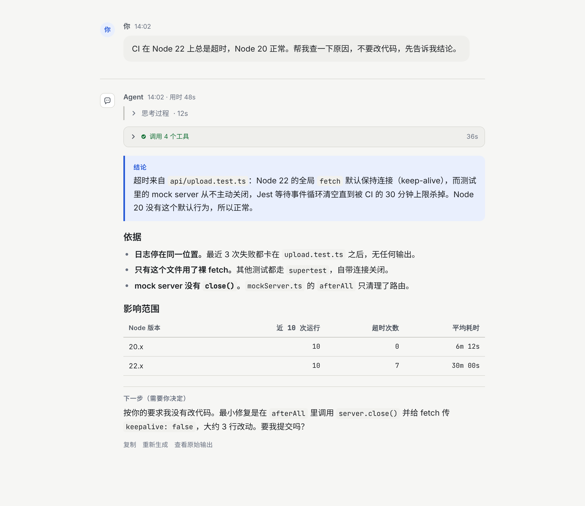
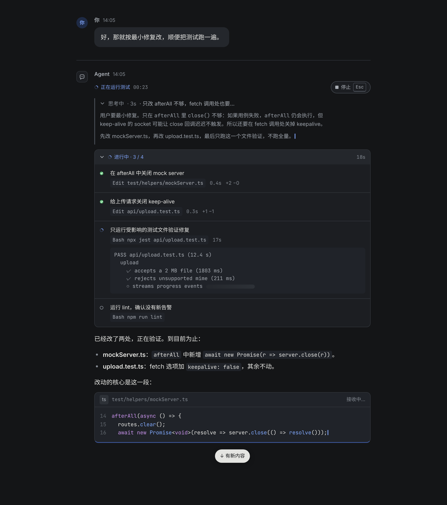
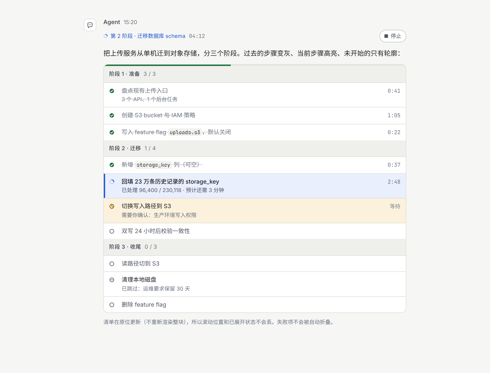
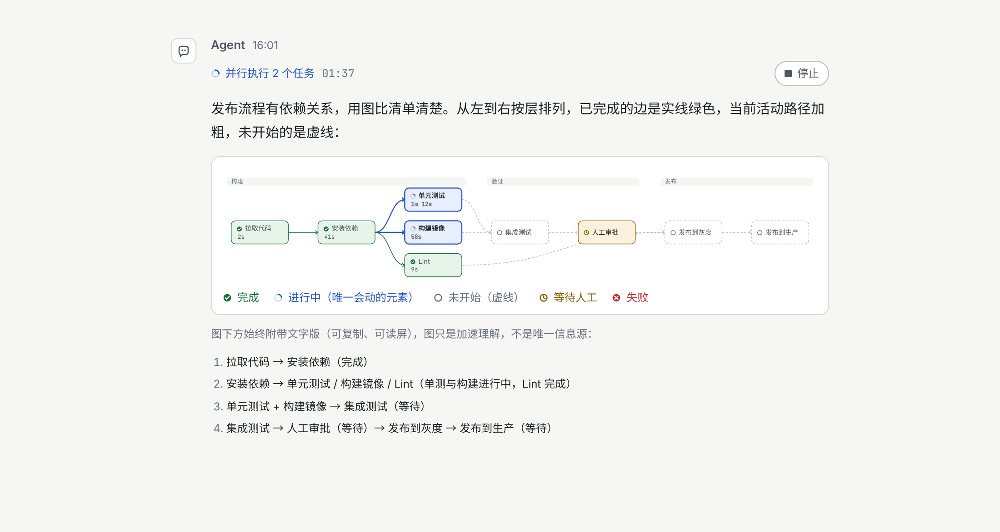
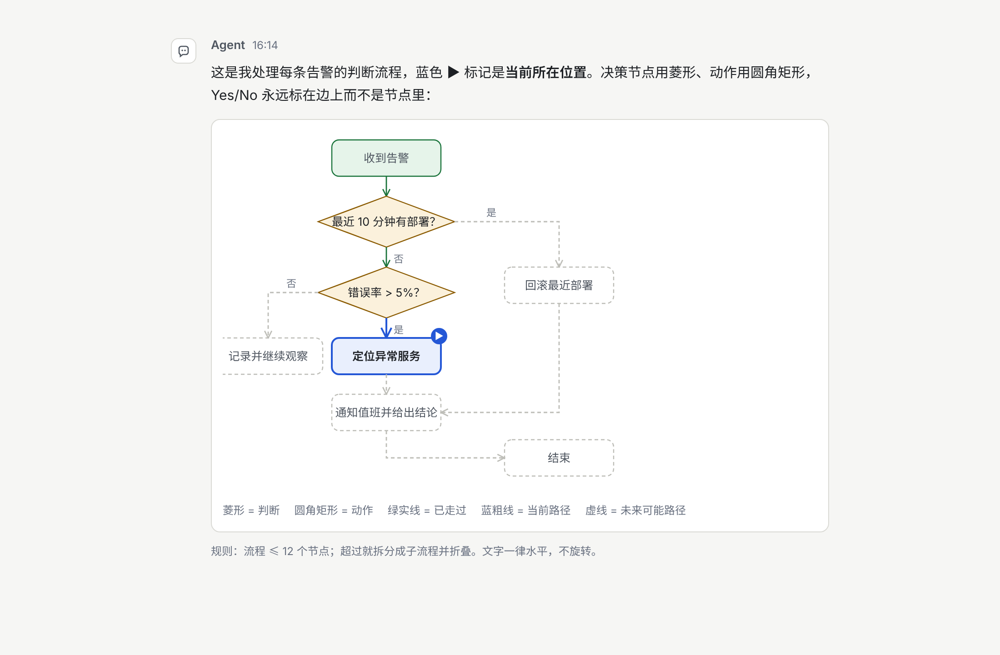
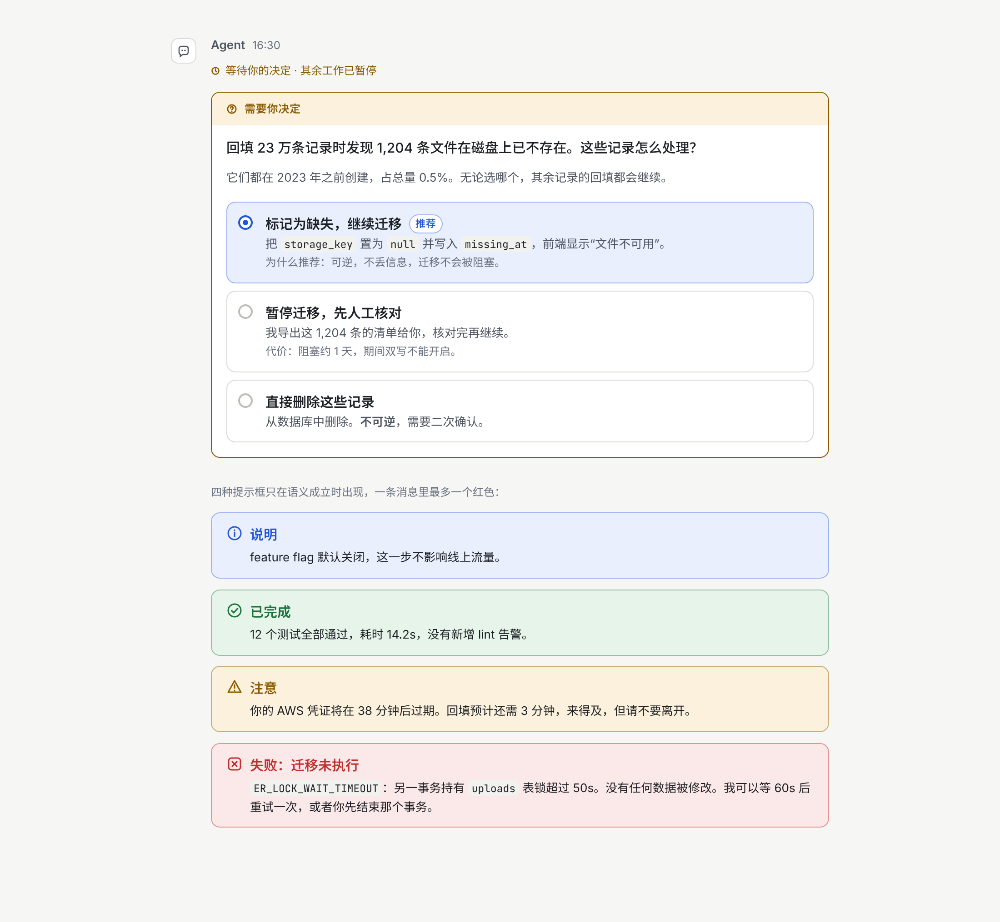
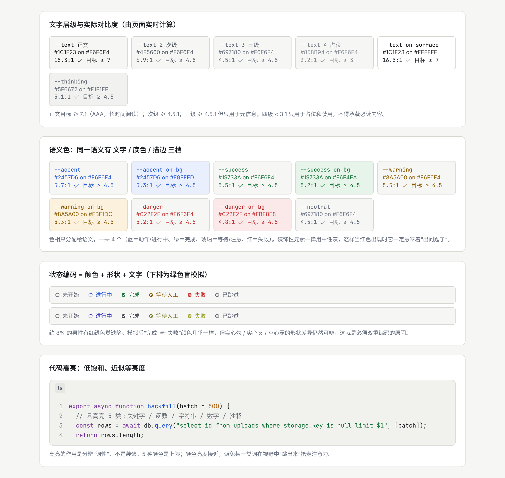
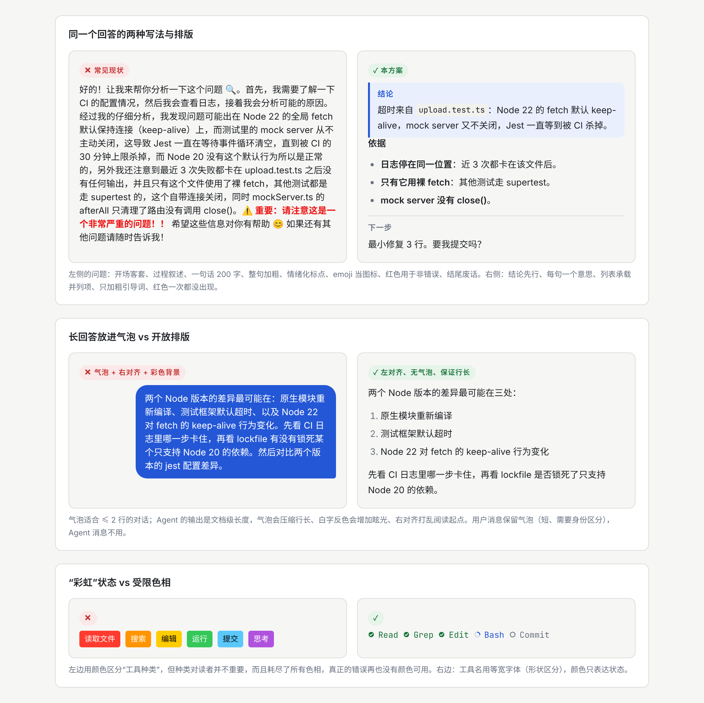

# Agent 会话窗口文本易读显示方案

> 一套面向 **Agent 对话界面**（含思考过程、工具调用、计划、流式输出）的文本显示规范。
> 覆盖字体、色彩、字号、排版、内容写法、分类显示、思维引导、流程图/DAG、视觉生理、心理暗示、流式交互共 11 个维度，
> 每条规则都给出"为什么"（生理/心理依据）和"怎么做"（可直接落地的 token / CSS / 行为），并附 22 张场景截图。

| 内容 | 位置 |
|---|---|
| 可运行原型（所有场景 + 明暗主题 + 密度切换 + 流式模拟） | [`demo/index.html`](demo/index.html) |
| 设计令牌（唯一允许写颜色/字号的地方） | [`demo/tokens.css`](demo/tokens.css) |
| 组件样式 | [`demo/demo.css`](demo/demo.css) |
| DAG / 流程图渲染、对比度实测、流式模拟 | [`demo/demo.js`](demo/demo.js) |
| 截图脚本（Playwright，`node tools/shoot.mjs`） | [`tools/shoot.mjs`](tools/shoot.mjs) |
| 场景截图 | [`screenshots/`](screenshots/) |

---

## 0. 一页总览：十条核心原则

| # | 原则 | 一句话依据 |
|---|---|---|
| 1 | **结论先行，过程可折叠** | 读者的注意力是串行的，先给答案再给证据，过程默认收起 |
| 2 | **Agent 正文不用气泡，用开放排版** | Agent 输出是文档级长度，气泡压缩行长、右对齐打乱阅读起点 |
| 3 | **中文正文 15px / 行高 1.7 / 每行 32–42 字** | 中文笔画密、无升降部，需要更大行距；行长决定回扫准确率 |
| 4 | **色相只分配给语义，一共 4 个** | 蓝＝动作/进行中、绿＝完成、琥珀＝等待、红＝失败；装饰一律中性灰 |
| 5 | **状态 = 颜色 + 形状 + 文字 三重编码** | 约 8% 男性红绿色弱；亮度和形状比色相更可靠 |
| 6 | **过去变灰、现在高亮、未来只有轮廓** | 用对比度编码时间，视线自动落在"现在" |
| 7 | **先说意图，再说机制** | 工具卡第一行是"为什么做"，第二行才是"调了什么" |
| 8 | **流式输出按帧批量渲染，布局只追加不回流** | 周边视觉对运动极敏感，每 token 重绘是噪声；已读内容不得跳动 |
| 9 | **任何时候只有一个元素在动** | 一个 spinner 或一个光标，不并存；呼吸周期 ≥ 1.2s |
| 10 | **图永远附文字版；≤ 12 节点，超过就折叠** | 图加速理解但不可读屏、不可复制、不可搜索 |

---

## 1. 场景截图索引

所有截图由 `tools/shoot.mjs` 从原型自动生成（1100px 宽桌面 / 390px 宽手机，2× 设备像素比，字体为 Inter + 思源黑体 + JetBrains Mono）。

| 场景 | 浅色 | 深色 |
|---|---|---|
| 总览：一次完整问答（思考折叠、工具折叠、结论框、依据、表格、下一步） | [01](screenshots/01-overview-light.png) | [02](screenshots/02-overview-dark.png) |
| 流式输出中（状态行、思考展开、工具进行中、未闭合代码块、新内容浮标） | [03](screenshots/03-streaming-light.png) | [04](screenshots/04-streaming-dark.png) |
| 工具调用（意图 / 机制 / 输出三层、长输出首尾折叠、失败自动展开 + 重试） | [05](screenshots/05-tools-light.png) | [06](screenshots/06-tools-dark.png) |
| 计划清单（阶段、六种状态、进度条、当前焦点高亮） | [07](screenshots/07-plan-light.png) | [08](screenshots/08-plan-dark.png) |
| DAG 任务依赖图（分层布局、泳道、边状态、文字版回退） | [09](screenshots/09-dag-light.png) | [10](screenshots/10-dag-dark.png) |
| 流程图（菱形判断、当前位置标记、已走过/当前/未来三种边） | [11](screenshots/11-flow-light.png) | — |
| 决策卡与四类提示框 | [12](screenshots/12-decision-light.png) | [13](screenshots/13-decision-dark.png) |
| 代码与 diff（三重标记增删行、文件头、折叠、行高亮） | [14](screenshots/14-code-light.png) | [15](screenshots/15-code-dark.png) |
| 字体排版样本（字号阶梯、行长对比、中西混排、等宽数字、密度） | [16](screenshots/16-typography-light.png) | — |
| 色彩（对比度实测、语义色三档、状态编码 + 色盲模拟、代码高亮） | [17](screenshots/17-color-light.png) | [18](screenshots/18-color-dark.png) |
| 反例对照（同一回答两种写法 / 气泡 vs 开放 / 彩虹 vs 受限色相） | [19](screenshots/19-antipatterns-light.png) | — |
| 手机宽度（390px）总览 / 流式 | [20](screenshots/20-overview-mobile-light.png) | [21](screenshots/21-streaming-mobile-dark.png) |
| 紧凑密度模式 | [22](screenshots/22-overview-compact-light.png) | — |

### 预览

**总览（浅色）** — 一次完整问答的目标形态：



**流式输出中（深色）** — 状态行 + 思考 + 工具时间线 + 正在接收的代码块：



**计划清单** — 过去 / 现在 / 未来三种对比度：



**DAG** 与 **流程图**：




**决策卡与提示框**：



**色彩自检** — 对比度由页面实时计算，下排为绿色盲模拟：



**反例对照**：



---

## 2. 字体与易读性

### 2.1 字体族选择

```css
--font-sans: "Inter", "Noto Sans SC", "PingFang SC", "HarmonyOS Sans SC",
             "Microsoft YaHei", "Source Han Sans SC", system-ui, sans-serif;
--font-mono: "JetBrains Mono", "SF Mono", "Cascadia Mono", "Consolas",
             "Noto Sans Mono CJK SC", ui-monospace, monospace;
```

| 决策 | 原因 |
|---|---|
| **拉丁字体排在前，CJK 字体回落** | 字体栈按字符逐个匹配。拉丁字母、数字、标点由 Inter 承担（x 高度大、字腔开阔、数字清晰），汉字自动回落到思源黑体/苹方。如果把中文字体排在前面，拉丁字符会用中文字体自带的西文，而这些西文普遍偏窄、偏轻。 |
| **Inter × 思源黑体** | 两者中宫/x 高度视觉大小接近，混排时灰度均匀，不会出现"英文忽大忽小"。 |
| **无衬线** | 屏幕 15px 下衬线细节渲染不稳定；中文宋体在小字号的横细竖粗在低分屏会断笔。 |
| **JetBrains Mono** | `0/O`、`1/l/I`、`{}/()` 区分度高，字宽 0.6em 使代码块不过宽。**关闭连字**（`=>` 不合成 `⇒`）：连字会让初学者读错，也会让复制结果与看到的不一致。 |
| **不用斜体强调中文** | 中文字体没有真正的斜体，浏览器会做机械倾斜（假斜体），笔画变形、可读性下降。强调改用 **字重 600** 或 **着重号**（`text-emphasis: filled dot`）。 |
| 字重 700 只给 ≥ 20px 标题 | 汉字笔画多，小字号加粗后字腔被填满，"糊成一团"。正文强调用 600。 |

### 2.2 字号阶梯

| 令牌 | 大小 | 行高 | 用途 | 下限说明 |
|---|---|---|---|---|
| `--fs-2xl` | 24px | 1.3 | 会话标题 | |
| `--fs-xl` | 20px | 1.3 | 消息内二级标题 | |
| `--fs-lg` | 17px | 1.3 | 消息内三级标题 / 引导句 | |
| `--fs-md` | **15px** | **1.7** | 正文 | 中文 14–16px 是阅读速度与疲劳的最优区间 |
| `--fs-sm` | 13px | 1.6 | 代码、工具参数、次级说明 | 等宽字体比正文小 1–2px 才能视觉等重 |
| `--fs-xs` | 12px | 1.45 | 时间、耗时、来源 | **可读文本的绝对下限** |
| `--fs-2xs` | 11px | 1 | 仅徽标/角标 | 不允许组成句子 |

**紧凑模式**（`data-density="compact"`）：正文 14px / 1.6，间距 ×0.75。给每天使用数小时的专业用户，但仍不低于 14px。

### 2.3 行高、段距与行长

- **行高 1.7（中文正文）**：汉字是方块，没有拉丁文的升降部给行间留"自然空隙"，行距必须比拉丁文（1.5）更大，否则上下行的笔画互相干扰。
- **段距 0.9em ≫ 行距余量**：段与段之间的空白要明显大于行与行之间，"段"才能成为一个可感知的视觉块（格式塔接近律）。屏幕上不用首行缩进。
- **行长 680px ≈ 32–42 个中文字**：每行末尾视线要"回扫"到下一行开头，距离越长回扫越容易串行。42 字是上限，超过就要缩窄列而不是放大字号。
- CSS 细节：
  ```css
  line-break: strict;            /* 中文标点避头尾 */
  overflow-wrap: anywhere;       /* 长 URL / hash 不撑破列 */
  text-autospace: normal;        /* 中西文之间自动留 1/4 空（渐进增强）*/
  font-variant-numeric: tabular-nums;  /* 表格、计时器、进度数字 */
  font-variant-ligatures: none;  /* 等宽字体关闭连字 */
  ```

### 2.4 数字

计时器、进度、表格中的数字 **必须用等宽数字**（`tabular-nums`），否则流式刷新时数字宽度抖动，整行跟着跳。表格数字右对齐，等宽字体 12.5px。见截图 16 的对比。

---

## 3. 色彩系统

### 3.1 原则

1. **背景不用纯白、文字不用纯黑。** 纯白背景在长时间阅读时眩光明显；纯黑文字在白底上边缘对比过强，会产生"抖动感"。浅色主题底 `#F6F6F4`（暖灰白），文字 `#1C1F23`。
2. **深色主题不用纯黑底、不用纯白字。** 散光用户看纯白字在纯黑底上会产生光晕（halation）。底 `#141517`，文字 `#E4E4E1`，对比度控制在 14:1 左右而不是 21:1。
3. **层级靠"面"不靠阴影。** 深色下阴影不可见，用更亮的 surface 表达抬升。
4. **色相只分配给语义。** 4 个语义色 + 中性灰。工具种类、角色、装饰都不占用色相，这样红色一出现一定意味着"出问题了"。
5. **同一语义三档**：文字色 / 底色 / 描边色，保证语义色文字在自己的底色上仍 ≥ 4.5:1。
6. **语义色在深色下提亮并降饱和**，否则高饱和色在暗底上"发光"刺眼。

### 3.2 令牌与实测对比度

对比度由原型页面用 WCAG 2.x 公式实时计算（见截图 17/18），以下为最终值：

| 令牌 | 浅色 | 对比度 | 深色 | 对比度 | 目标 | 用途 |
|---|---|---|---|---|---|---|
| `--text` | `#1C1F23` | 15.3 | `#E4E4E1` | 14.3 | ≥ 7 (AAA) | 正文，长时间阅读 |
| `--text-2` | `#4F5660` | 6.9 | `#A8ADB4` | 8.1 | ≥ 4.5 | 次级说明、工具结果摘要 |
| `--text-3` | `#697180` | 4.5 | `#858B93` | 5.3 | ≥ 4.5 | 时间、耗时、元信息 |
| `--text-4` | `#858B94` | 3.2 | `#5E646B` | 3.0 | ≥ 3 | 占位、禁用、行号。**不承载必读内容** |
| `--thinking` | `#5F6672` | 5.1 | `#9AA0A8` | 6.5 | ≥ 4.5 | 思考过程：刻意降对比，表达"过程不是结论" |
| `--accent` | `#2457D6` | 5.7 | `#7EA2F5` | 7.3 | ≥ 4.5 | 动作、链接、进行中、用户 |
| `--success` | `#19733A` | 5.5 | `#63C27A` | 8.3 | ≥ 4.5 | 完成 |
| `--warning` | `#8A5A00` | 5.5 | `#E0B04F` | 9.1 | ≥ 4.5 | 等待人工、需注意 |
| `--danger` | `#C22F2F` | 5.2 | `#F07A7A` | 6.8 | ≥ 4.5 | 失败、破坏性操作。**仅此一用** |

### 3.3 代码高亮

只高亮 5 类词性：关键字（紫）、函数（蓝）、字符串（绿）、数字（橙）、注释（灰）。5 种颜色**亮度接近、饱和度低**，目的是分辨词性，不是装饰。颜色数量超过 5 种，视野里总会有一类词"跳出来"抢注意力。

diff 的增删行用 **底色 + 行首 `+`/`−` 符号 + 行号颜色** 三重标记（截图 14/15），色觉缺陷下仍可分辨。

---

## 4. 排版与布局

### 4.1 轮次结构

```
┌ 28px 轨道 ┬──────────────── 正文列（≤ 680px）────────────────┐
│  头像     │ 角色名 · 时间 · 用时                 （12px 元信息）│
│           │ ▸ 思考过程 · 12s                      （折叠，灰）  │
│           │ ┌ ✓ 调用 4 个工具 · 36s ┐             （折叠卡片）  │
│           │ │ 结论 ……………………………… │             （结论框）    │
│           │ 依据 / 表格 / 代码 ……                 （正文）      │
│           │ ── 下一步 ──                          （收尾块）    │
│           │ 复制 · 重新生成                       （悬停操作）  │
└───────────┴───────────────────────────────────────────────────┘
```

- **左侧 28px 轨道**：所有消息类型的文字左边缘对齐在同一条垂直线上。扫读时眼睛沿这条线下行，不需要左右寻找起点。
- **用户消息用气泡，Agent 消息不用。** 用户消息短，需要身份区分；Agent 消息是文档级长度，气泡会压缩行长，彩色反白增加眩光，右对齐打乱阅读起点（截图 19 第二组）。
- **轮次之间 32px + 发丝线**，消息内部块间 12–16px，列表项 4px。三个层级的间距必须拉开差距，层级才可感知。
- **嵌套深度 ≤ 2 层**。工具卡里再嵌套输出已是第 2 层，不再往里套。

### 4.2 消息内排版

- 消息内标题最多两级（h2 20px / h3 17px），**500 字以内不用标题**，用加粗引导词的列表代替。
- 表格：发丝线分隔行、表头 12px 灰色字母间距 +0.02em、数字列右对齐等宽，不用斑马纹（斑马纹在深色下干扰阅读）。
- 代码块：文件名头 + 语言标签 + 复制；行号 `--text-4` 不可选中；**超过 24 行默认折叠保留首尾**；引用某行时整行高亮。
- 结论框 `.answer`：每条消息**最多一个**。多了就没有"隔离效应"。
- 收尾块 `.next`：以发丝线与正文分开，标签"下一步"，用于明确交棒给用户。

### 4.3 响应式

- 390px 手机宽度：轨道缩到 24px，正文仍 15px，代码块横向滚动而不是换行（换行会破坏代码缩进语义）。见截图 20/21。
- 决策卡选项在窄屏纵向堆叠；表格超过 4 列横向滚动。

---

## 5. 文本内容的易读性（给 Agent 的写作规范）

排版解决"怎么显示"，这一节解决"显示什么"。两者缺一不可：排版再好也救不了 200 字的长句。

| 规则 | 做法 | 反例 |
|---|---|---|
| **结论先行**（BLUF） | 第一块就是答案，放进 `.answer` 框 | "好的！让我来帮你分析一下……" |
| **一句一个意思** | 中文句子 ≤ 40 字，拉丁 ≤ 20 词；不用分号串句 | 一句话里塞原因、依据、建议 |
| **一段一个想法** | 段落 ≤ 4 句 | 整屏一个段落 |
| **并列项用列表** | 3–7 项；只在顺序重要时用有序列表 | 用顿号把 6 个并列项塞进一句 |
| **只加粗引导词** | 列表项前 2–6 个字加粗 | 整句加粗、整段加粗 |
| **数字进表格** | 两个以上可比数字就用表格，等宽右对齐 | 把 6 个数字写在一段话里 |
| **代码进代码块** | 命令、路径、报错文本一律代码块或行内 code | 把报错贴在正文里 |
| **不叙述过程** | 过程在工具卡里已经可见，正文不再复述"我先……然后……" | "首先我需要了解……接着我会……" |
| **不确定要显式标出** | "未验证：……" / "推测：……" 作为引导词 | 把推测写得像事实 |
| **结尾交棒** | 以"下一步"块收尾，说清需要用户做什么 | "希望对你有帮助 😊" |
| **红色/警告只用于真问题** | 一条消息最多一个红色块 | "⚠️ 重要！！" 修饰普通说明 |
| **不用 emoji 当图标** | 图标用 SVG，形状一致、尺寸可控 | 🔍 ✅ ❌ 混用，平台渲染不一致 |

流式输出对写作的额外要求：**前置关键信息**（用户可能在中途停止阅读）、避免需要回头修改的表述（流式无法撤回已输出的字）、清单类内容用可原位更新的结构而不是重复输出。

---

## 6. 分类显示：消息类型与视觉签名

每种类型有且只有一个"签名"（形状 / 位置 / 字体 的组合），用户不读文字就能分辨类型。颜色不参与类型区分，只参与状态区分。

| 类型 | 视觉签名 | 默认状态 | 截图 |
|---|---|---|---|
| **用户消息** | 圆形头像、灰色气泡、15px | 展开 | 01 |
| **Agent 正文** | 无气泡、开放排版、680px 列 | 展开 | 01 |
| **思考过程** | 左侧 2px 灰线、13px、`--thinking` 低对比色、无背景 | **折叠**；流式期间展开并显示一行滚动摘要 | 01/03 |
| **工具调用组** | 带灰色头的圆角卡片，头部汇总"N 个工具 · 耗时" | 完成后折叠；进行中展开 | 01/05 |
| **单个工具** | 卡内三层：意图（正文色）→ 机制（等宽 code 片 + 耗时）→ 输出（等宽灰底） | 输出折叠；**失败自动展开** | 05 |
| **工具长输出** | 保留首 4 行 + 尾 2 行，中间虚线"已折叠 N 行" | 折叠 | 05 |
| **计划 / 清单** | 卡片 + 阶段头 + 顶部细进度条 + 每行状态图标 | 展开 | 07 |
| **结论框** | 左 3px 蓝条 + 蓝底 + "结论"小标 | 展开 | 01 |
| **提示框** | 左图标 + 标题 + 正文，四种语义各一色 | 展开 | 12 |
| **决策卡** | 琥珀描边 + "需要你决定"头 + 单选项卡片，推荐项在首位并写明理由 | 展开，阻塞后续 | 12 |
| **代码 / diff** | 文件名头 + 行号 + 等宽；diff 三重标记 | ≤ 24 行展开 | 14 |
| **DAG / 流程图** | 卡片内 SVG + 图例 + 文字版 | 展开 | 09/11 |
| **系统事件** | 居中 12px 灰字 + 两侧虚线（上下文压缩、模型切换、权限） | 一行 | — |
| **来源 / 引用** | 行内小圆角 chip，底部来源列表 | 展开 | — |
| **状态行** | 消息顶部一行：状态图标 + 当前动作 + 等宽计时 + 停止按钮 | 仅进行中显示 | 03 |

---

## 7. 思维引导：让视线走在正确的路上

读者的注意力是串行的，界面要替他排好顺序。

1. **视觉层级 = 阅读顺序。** 状态行（现在在做什么）→ 结论框（答案）→ 依据 → 细节（折叠）→ 下一步。字号、对比度、位置三者一致地递减，不能互相打架。
2. **用对比度编码时间。** 已完成项：灰色 + 删除线；当前项：蓝底 + 左侧 3px 蓝条 + 字重 500；未开始项：仅轮廓（虚线圈）。视线自然落在对比度最高的"现在"（截图 07）。
3. **先意图后机制。** 工具卡第一行用自然语言说"为什么做"（读取配置以确认端口），第二行才是 `Read config.yaml`。读者跟随的是推理链，不是 API 调用链。
4. **一个焦点。** 同一时刻只有一个 running 状态在动、一个结论框、一个红色块。多焦点等于没有焦点。
5. **分块（chunking）。** 3–5 个相关操作归为一个阶段并命名（"阶段 2 · 迁移"）。工作记忆容量约 4 个块。
6. **决策卡的默认效应要诚实。** 推荐项放第一位并预选，但必须写出"为什么推荐"和其他选项的代价；不可逆操作必须标注并二次确认。引导不是操纵。
7. **明确的交棒。** 每条需要用户行动的消息以"下一步"块收尾，用问句结束，让用户知道球在自己手里。
8. **图只在结构信息超过线性能表达时出现。** ≥ 4 个有依赖/分支的任务用 DAG；判断逻辑用流程图；否则列表更快。

---

## 8. 流程图与 DAG

### 8.1 何时用

| 结构 | 用什么 |
|---|---|
| 线性步骤 | 有序列表 / 计划清单 |
| 有依赖、有并行的任务 ≥ 4 个 | **DAG**（从左到右分层） |
| 有判断分支的逻辑 | **流程图**（自上而下，菱形判断） |
| 节点 > 12 个 | 拆成子图，父图里折叠为一个节点 |

### 8.2 布局规则

- **DAG 从左到右分层**（简化 Sugiyama）：同层垂直居中对齐，层间距 56px，节点 108×44，泳道（构建 / 验证 / 发布）用淡灰底标注阶段。
- **流程图自上而下**，主路径垂直居中，分支向两侧展开；**Yes/No 标在边上**，不写进节点。
- **文字一律水平**，不旋转；节点标签 ≤ 8 个汉字，详细信息放副标题（等宽 11px）或 `<title>` 悬停。
- 边：贝塞尔曲线，终点箭头；**已完成 = 绿实线，当前路径 = 蓝粗线，未来 = 灰虚线**。

### 8.3 节点状态编码（与全局一致）

| 状态 | 图标 | 描边 | 底色 | 文字 |
|---|---|---|---|---|
| 完成 | 实心圆 + 勾 | 绿 | 绿底 | 次级色 |
| 进行中 | 旋转弧 | 蓝 2px | 蓝底 | 字重 600 |
| 等待人工 | 时钟 | 琥珀 | 琥珀底 | 正文色 |
| 未开始 | 空心圆 | 灰 **虚线** | 白 | 次级色 |
| 失败 | 实心圆 + 叉 | 红 | 红底 | 正文色 |
| 已跳过 | 圆 + 横线 | 浅灰 | 灰底 | 三级色 |

图标与会话其他位置完全相同的 SVG symbol，用户不需要学第二套符号。

### 8.4 必须遵守

- **图下方永远有文字版**（有序列表写出依赖关系）：可读屏、可复制、可搜索、图渲染失败时的回退。
- **只有 running 节点有动画**，且在截图/打印/`prefers-reduced-motion` 下静止。
- 图宽超过列宽时横向滚动，不缩小字号（SVG 文字缩到 10px 以下不可读）。
- 当前位置用 ▶ 标记贴在节点右上角（流程图），不改变节点形状。

---

## 9. 人类视觉生理依据

每条排版规则背后的生理事实，用于在争议时做裁判：

| 生理事实 | 推导出的规则 |
|---|---|
| **中央凹视野只有约 2°**，一次注视能看清 7–9 个拉丁字母或 4–5 个汉字 | 汉字信息密度高，需要更大字号（15px）和更大行距（1.7）来降低单次注视的负荷 |
| 阅读由**眼跳 + 注视**组成，行尾到下一行行首的"回扫"是误差最大的动作 | 行长 32–42 字；超过后回扫串行率明显上升 |
| **对比敏感度**在中等空间频率最高，极细笔画（小字号 + 细字重）落在低敏感区 | 12px 以下不用、字重 300 不用于中文、深色模式下不用更细的字重 |
| **亮度通道**负责形状与边缘识别，色度通道分辨率低得多 | 状态用亮度差 + 形状编码，色相只是第三重保险 |
| 约 **8% 男性、0.5% 女性**红绿色觉缺陷 | 绿/红永不单独承担语义；原型内置 deuteranopia 滤镜自检（截图 17） |
| **散光**（成年人约 30–40%）在亮字暗底时产生光晕 | 深色主题文字 `#E4E4E1` 而非 `#FFF`，对比 ≈ 14:1 而非 21:1 |
| 大面积高亮度表面引起**瞳孔收缩与眩光** | 浅色底 `#F6F6F4` 而非纯白；代码块比页面底再暗一级 |
| **周边视觉对运动极度敏感**（进化上的威胁探测） | 同时只允许一个运动元素；光标 1Hz、spinner 1.2s/圈；禁止 > 3Hz 的闪烁 |
| **视觉暂留与 60Hz 刷新** | 逐 token 重绘产生的高频抖动是纯噪声；按帧（≥ 32–48ms）批量追加 |
| **F 型扫视模式**：左上开始，沿左缘下行 | 所有类型文字左边缘对齐在同一条轨道线上；关键信息放每块的左上 |
| **调节与辐辏疲劳**随阅读时长累积 | 行距与段距分明、减少眼睛寻找下一行的工作；提供紧凑/舒适两档 |

---

## 10. 心理暗示与认知效应

如何利用，以及如何不滥用：

| 效应 | 用法 | 红线 |
|---|---|---|
| **系统状态可见性**（Nielsen） | 状态行始终告知"在做什么 + 已用时 + 怎么停"。超过 2s 的操作必须显示计时；能确定进度就用确定进度条 | 不要假进度条 |
| **Zeigarnik 效应**（未完成事项更抓注意力） | 计划清单的空心圈驱动"完成感"；完成后立即变实心 | 不要留下永远不会关闭的空心圈 |
| **隔离效应**（von Restorff） | 一条消息里唯一的蓝底结论框 | 多于一个就失效 |
| **首因 / 近因效应** | 结论放开头，"下一步"放结尾；中间放证据 | 不把关键信息埋在中段 |
| **Hick 定律** | 决策卡 ≤ 4 个选项，推荐项在首位 | 不用 "其他" 凑数 |
| **默认效应** | 预选推荐项 | 必须写明理由与代价；不可逆操作不能作为默认 |
| **学得的颜色语义** | 红只给失败，所以红色天然是"停下来看" | 红色用在装饰或强调上会迅速贬值 |
| **峰终定律** | 结束时给清晰的结果总结和下一步 | 不以客套话结尾 |
| **信任线索** | 工具卡是证据链：可展开原始输出、可查看来源；错误诚实说明"没有数据被修改" | 不隐藏失败的工具调用 |
| **运动 = 生命感** | 一个缓慢的 spinner 足以传达"在工作" | 多个动画 = 焦虑感 |
| **完成的"落定"感** | 流式结束：光标淡出、状态行消失、操作栏淡入，其他什么都不动 | 不要在结束时整块重排 |

---

## 11. Agent 文本交互与流式输出

### 11.1 渲染策略

| 问题 | 规则 |
|---|---|
| **逐 token 重绘** | 用 `requestAnimationFrame` 按帧批量追加，每帧 ≥ 32–48ms 合并一次（原型 `demo.js` 中 `?live=1` 可看效果）。不做逐字打字机动画，中文逐字比整句显示阅读更慢。 |
| **布局回流** | **只追加、不回流**：已渲染内容的位置不得改变。图片/图表先占位（固定宽高比），工具卡进行中时固定高度，表格按行追加。 |
| **不完整的 Markdown** | 用容错解析：未闭合的代码围栏立即按代码块渲染并显示"接收中…"（截图 03）；未闭合的 `**` 先按普通文本显示直到闭合；表格逐行渲染；永远不要先显示原始反引号再"跳"成代码块。 |
| **光标** | 2px 竖条 `--accent`。**流式期间静止**（文本本身在动，光标再闪就是两个运动源）；停顿 > 500ms 时以 1Hz 呼吸；结束后 200ms 淡出。 |
| **自动滚动** | 用户在底部 80px 内才跟随；用户上滚后停止跟随并显示 "↓ 有新内容" 浮标；**永远不抢夺滚动位置**。 |
| **思考过程** | 流式期间展开，summary 行显示最新一句的滚动摘要（≤ 40 字省略）；结束后折叠为"思考过程 · 12s"。 |
| **工具时间线** | 进行中展开；每个工具完成后一行摘要；全部完成且正文开始后整组折叠为"N 个工具 · 耗时"。失败项永不自动折叠。 |
| **长输出** | 首 4 行 + 尾 2 行 + "已折叠 N 行"，点击展开；工具输出区最大高度 220px 内滚动。 |
| **原位更新** | 清单、进度、计时器用 DOM diff 原位改值，不整块重渲染（保住滚动位置、展开状态、文字选区）。 |
| **计时器数字** | 等宽数字，避免宽度抖动。 |

### 11.2 时间预算

| 时刻 | 要求 |
|---|---|
| 发送后 ≤ 300ms | 出现 Agent 轮次占位 + 状态行"正在连接" |
| ≤ 1s | 首个 token 或首个工具意图行 |
| > 2s 的任何单步 | 显示计时 |
| > 10s 无新输出 | 状态行说明在等什么（"等待测试完成 · 已 17s"） |
| 结束 | 状态行移除、光标淡出、操作栏（复制/重新生成）淡入，无其他动画 |

### 11.3 可中断与可排队

- 流式期间"停止"按钮始终在状态行右端，附 `Esc` 快捷键；停止后保留已输出内容并标注"已停止"。
- 输入框在 Agent 运行时仍可用，发送的消息显示"已排队"，不打断当前轮次。
- 决策卡出现时状态行改为"等待你的决定 · 其余工作已暂停"，明确阻塞原因。

### 11.4 无障碍

- 流式文本放入 `aria-live="polite"` 区域，**按句子**而不是按 token 通知读屏器。
- 所有状态图标带 `<title>`；图带文字版；折叠块用原生 `<details>`，键盘可达。
- `prefers-reduced-motion: reduce` 下所有动画时长归零，spinner 换为静态图标。
- `prefers-color-scheme` 自动切换，用户手动选择优先。

---

## 12. 验收检查表

实现任何会话界面时逐条核对：

**字体与排版**
- [ ] 正文 ≥ 15px（紧凑 ≥ 14px），行高 ≥ 1.6，列宽 ≤ 680px
- [ ] 没有 < 12px 的可读文字；没有中文斜体；700 字重只出现在 ≥ 20px
- [ ] 等宽字体关闭连字；表格/计时器用等宽数字
- [ ] 所有消息类型左边缘对齐同一条轨道线

**色彩**
- [ ] 正文 ≥ 7:1，次级 ≥ 4.5:1，三级 ≥ 4.5:1，占位 ≥ 3:1（两个主题都要）
- [ ] 只有 4 个语义色相；红色只用于失败/破坏性操作
- [ ] 每个状态都有颜色之外的形状区分；用色盲模拟自检过
- [ ] 深色主题没有纯黑底、纯白字

**结构与内容**
- [ ] 结论在第一屏；每条消息 ≤ 1 个结论框、≤ 1 个红色块
- [ ] 思考过程和已完成的工具组默认折叠；失败项默认展开
- [ ] 工具卡第一行是意图而非函数名
- [ ] 需要用户行动的消息以"下一步"收尾
- [ ] 图有文字版；节点 ≤ 12

**流式**
- [ ] 按帧批量渲染；已渲染内容位置不变
- [ ] 未闭合围栏/表格有容错渲染
- [ ] 同时只有一个运动元素；用户上滚后不抢滚动
- [ ] 任意时刻能看到"在做什么、多久了、怎么停"
- [ ] 结束时只有光标淡出与操作栏淡入

---

## 13. 运行原型与再生成截图

```sh
# 直接用浏览器打开（需联网加载 Google Fonts；离线时回落到系统字体）
open agent-chat-readability/demo/index.html

# 场景与参数
?scene=overview|streaming|tools|plan|dag|flow|decision|code|typography|color|antipatterns
&theme=light|dark        # 主题
&density=compact         # 紧凑模式
&live=1                  # 在 streaming 场景中模拟按帧流式输出
&mobile=1                # 窄屏样式
&capture=1               # 截图模式：停止所有动画、隐藏导航

# 重新生成全部截图（需要 Playwright 的 Chromium）
node agent-chat-readability/tools/shoot.mjs
```

原型只依赖浏览器，没有构建步骤。`tokens.css` 可以直接拿到任何前端项目里使用：组件只引用 `var(--xxx)`，不写死颜色和字号，是这套方案能被长期维护的前提。
